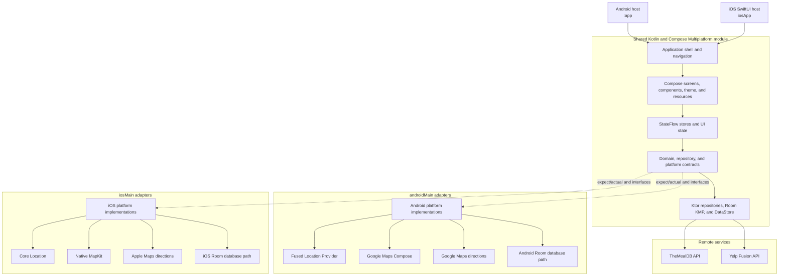

# Recipe Compose

Recipe Compose began as a project to learn Jetpack Compose. I later added restaurant search and migrated the app to Compose Multiplatform. It runs on Android and iOS with shared UI and state.

Users can browse meals from TheMealDB, save recipes locally, find restaurants through Yelp, and open driving directions from a map. Shared code handles onboarding, search, saved dishes, networking, and persistence. Platform code handles permissions, location, maps, and external navigation.

## App demo

<p align="center">
  <a href="docs/demo/recipe-compose-demo.m4v">
    
  </a>
</p>

<p align="center">
  <strong><a href="docs/demo/recipe-compose-demo.m4v">Watch the Android and iOS walkthrough</a></strong>
</p>

## Features

- First-run onboarding introduces recipe discovery, saved dishes, and restaurant search.
- Use the navigation bar to switch between recipes, search, nearby restaurants, and saved dishes.
- Browse recipe categories or search for dishes by name.
- Read recipe details, open the original source or video, and save recipes locally.
- Open saved recipes, remove one with confirmation, or swipe to delete it.
- Find Yelp restaurants using the device's current location or a city or ZIP code. The app remembers a successful device-location choice for later visits.
- Search the loaded area by restaurant name or cuisine.
- View a selected restaurant on an interactive Google Map on Android or native MapKit map on iOS.
- Move the destination marker and open driving directions to that location.
- Show loading, error, and connectivity states.

## Implementation

- Compose Multiplatform screens with Material 3.
- Shared stores and Android ViewModels expose UI state through `StateFlow`.
- Flow collection follows the screen lifecycle.
- UI events handle retries, searches, refreshes, dialogs, favorites, and navigation.
- Remote search uses debounce and cancels outdated requests.
- Shared Ktor clients with `kotlinx.serialization` and Ktor `MockEngine` contract tests.
- Navigation Compose routes with state passed between destinations.
- Shared Compose components for dialogs, media cards, links, lists, and navigation controls.
- A shared recipe-details page reused by Featured Dish, search results, and saved-dish destinations.
- A debug-only preview catalog with sample data and light and dark previews.
- Feeds, galleries, and saved-dish lists use layouts suited to their content.
- A shared Material 3 theme defines light and dark colors, typography, spacing, and shapes.
- A shared startup screen follows the app theme on Android and iOS.
- Shared screen transitions and a progress indicator driven by animation frames.
- Room KMP stores favorites locally, with database construction in each platform's source set.
- Preferences DataStore stores onboarding completion and the user's choice to use device location.
- Driving directions use the selected map marker.
- Foreground-only location access with support for approximate and precise permission.
- Location permission is requested after the user chooses device location. The app tries a recent coordinate, then requests a new location with a timeout. Manual search remains available if location lookup fails.
- Build-time credential injection, redacted authorization headers, and debug-only HTTP body logging.
- Companion documentation for the UI redesign, Gradle Kotlin DSL migration, KMP assessment, and Compose Multiplatform migration path.

## Restaurant navigation

The restaurant search follows these steps:

```text
User chooses current location or enters an area
        ↓
Foreground permission when needed (approximate or precise)
        ↓
Nearby Yelp restaurant discovery
        ↓
Restaurant selection
        ↓
Interactive map and destination marker
        ↓
Optional marker adjustment
        ↓
Platform driving directions
```

Location access is requested after the user chooses **Use my location**. After a successful request, Preferences DataStore saves that choice for later Nearby visits. The app checks the operating system's permission grant each time. If access is revoked, it returns to the permission or manual-search option.

The app uses a recent coordinate when available. Otherwise, it requests a new location with a timeout. Users can enter a city or ZIP code if access is declined or a location is unavailable. The app stores neither exact coordinates nor location history and does not request background location.

The directions action uses either the restaurant marker or the user-adjusted marker as its destination. Android hands the destination to Google Maps-compatible navigation; iOS opens Apple Maps for driving directions. The navigation app manages the route origin after the handoff.

## Architecture

The Android and iOS apps use a Kotlin Multiplatform `:shared` library. Common code contains UI, state, repositories, networking, resources, and persistence contracts. Platform source sets and host apps provide lifecycle integration, storage paths, permissions, location, maps, and external navigation.



```text
RecipeCompose/
├── app/                         Installable Android host and Android configuration
├── shared/
│   └── src/
│       ├── commonMain/          Shared app shell, Compose UI, state, domain, and data
│       ├── androidMain/         Android location, maps, storage, and back handling
│       ├── iosMain/             iOS entry point, location, MapKit, and storage
│       └── commonTest/          Shared repository, state, persistence, and contract tests
├── iosApp/                      Installable SwiftUI/Xcode host
├── docs/                        Migration decisions, implementation notes, and screenshots
└── gradle/                      Version catalog and shared build configuration
```

Place shared UI and navigation in `shared/src/commonMain/.../presentation`, contracts and state models under `domain`, and Ktor and Room implementations under `data`. Platform permissions, location, maps, storage paths, and external actions belong in their platform source sets or host apps. Koin supplies those implementations.

## Technology

| Area | Implementation |
| --- | --- |
| User interface | Compose Multiplatform, Jetpack Compose, Material 3 |
| State and lifecycle | Shared stores, ViewModel adapters, StateFlow, lifecycle-aware collection |
| Navigation | Navigation Compose and a shared iOS application shell |
| Networking | Ktor Client, OkHttp/Darwin engines, kotlinx.serialization |
| Local persistence | Room KMP, Preferences DataStore |
| Recipe data | TheMealDB API |
| Restaurant discovery | Yelp Fusion API |
| Location and mapping | Fused Location Provider/Google Maps on Android; Core Location/MapKit on iOS |
| Dependency injection | Koin |
| Build tooling | Kotlin Multiplatform, Kotlin DSL, version catalogs, KSP, Secrets Gradle Plugin, Xcode |

## Project setup

### Prerequisites

- Android Studio and a compatible Android SDK.
- Xcode with the iOS simulator runtime for iOS development.
- An Apple development team configured in Xcode when running on a physical iPhone.
- A Google Maps Platform API key with Maps SDK for Android enabled.
- A Yelp Fusion API key.

### Installation

1. Clone the repository:

   ```bash
   git clone git@github.com:GetRighhttt/RecipeCompose.git
   cd RecipeCompose
   ```

2. Add the following values to the root `local.properties` file:

   ```properties
   MAPS_API_KEY=your_google_maps_key
   YELP_API_KEY=your_yelp_fusion_key
   YELP_BASE_URL=https://api.yelp.com/v3/
   BASE_URL=https://www.themealdb.com/api/json/v1/1/
   ```

   `local.properties` is excluded from version control. The checked-in `local.defaults.properties` supplies defaults for project sync and CI builds without credentials.

3. Build the debug application:

   ```bash
   ./gradlew :app:assembleDebug
   ```

4. Run the `app` configuration on an Android device or emulator with Google APIs. For iOS, open `iosApp/iosApp.xcodeproj` in Xcode or use the checked-in `iosApp` Xcode Application configuration in Android Studio. Select a development team under **Signing & Capabilities** before installing on a physical iPhone.

On the first Nearby visit, choose **Use my location** and grant foreground access, or enter a city or ZIP code. After a successful device-location request, the app remembers that choice. **Choose another location** resets it.

## Credential handling

Android receives credentials through generated `BuildConfig` fields and manifest placeholders. The iOS framework receives Yelp configuration from ignored build output, with an optional Xcode build-setting override.

Build-time configuration keeps credentials out of Git. Credentials can still be extracted from a compiled app. For deployment:

- Restrict the Maps key to the application ID and signing-certificate fingerprint.
- Use separate development and production credentials.
- Keep real credentials out of `local.defaults.properties`.
- Route Yelp requests through a backend service if the credential must remain confidential.

## Verification

Run the Android build, Android checks, and shared test suite with:

```bash
./gradlew :app:assembleDebug :app:testDebugUnitTest :app:lintDebug :shared:allTests
```

Compile the shared UI for the Apple simulator target with:

```bash
./gradlew :shared:compileKotlinIosSimulatorArm64
```

Additional engineering notes are tracked in [`docs/`](docs), including the [cleanup audit](docs/CODE_CLEANUP_AUDIT.md), [retained location preference implementation](docs/LOCATION_PREFERENCE_PLAN.md), [theme and UI redesign](docs/THEME_AND_UI_REDESIGN.md), [Gradle Kotlin DSL migration notes](docs/GRADLE_KOTLIN_DSL_MIGRATION.md), [KMP migration assessment](docs/KMP_MIGRATION_ASSESSMENT.md), and [Compose Multiplatform migration plan](docs/COMPOSE_MULTIPLATFORM_MIGRATION_PLAN.md).

For visual iteration, open `app/src/debug/java/com/example/recipe_app_compose/preview/ScreenPreviews.kt` with the Debug build variant selected. Android Studio can render the main screens in light and dark mode without launching the app. Shared fixtures live beside it in `PreviewData.kt` and are excluded from release builds.

## Screenshots

Android and iOS use shared Compose components, themes, and feature state.
Each platform supplies its own location, map, and navigation integrations.

### Android

<table>
  <tr>
    <td align="center">
      
      <br />
      <sub><strong>First-run onboarding</strong></sub>
    </td>
    <td align="center">
      
      <br />
      <sub><strong>Explore and discover</strong></sub>
    </td>
    <td align="center">
      
      <br />
      <sub><strong>Search dishes</strong></sub>
    </td>
  </tr>
</table>

### iOS

These screens are rendered by the shared Compose Multiplatform UI. Core
Location and MapKit remain native platform adapters behind the common feature
contracts.

<table>
  <tr>
    <td align="center">
      
      <br />
      <sub><strong>Shared first-run onboarding</strong></sub>
    </td>
    <td align="center">
      
      <br />
      <sub><strong>Explore and discover</strong></sub>
    </td>
    <td align="center">
      
      <br />
      <sub><strong>Search dishes</strong></sub>
    </td>
  </tr>
  <tr>
    <td align="center">
      
      <br />
      <sub><strong>Location-aware discovery</strong></sub>
    </td>
    <td align="center">
      
      <br />
      <sub><strong>Native MapKit destination</strong></sub>
    </td>
    <td align="center">
      
      <br />
      <sub><strong>Local saved dishes</strong></sub>
    </td>
  </tr>
  <tr>
    <td align="center" colspan="3">
      
      <br />
      <sub><strong>Shared recipe details and saved-dish management</strong></sub>
    </td>
  </tr>
</table>

## Contributing

1. Fork the repository and create a focused branch.
2. Implement and test the change.
3. Run the verification commands above.
4. Open a pull request. GitHub automatically loads the repository's [pull request template](.github/pull_request_template.md); complete its summary, platform-impact, verification, and screenshot sections.

## Contact

Questions and feedback: stefanbusiness95@gmail.com
